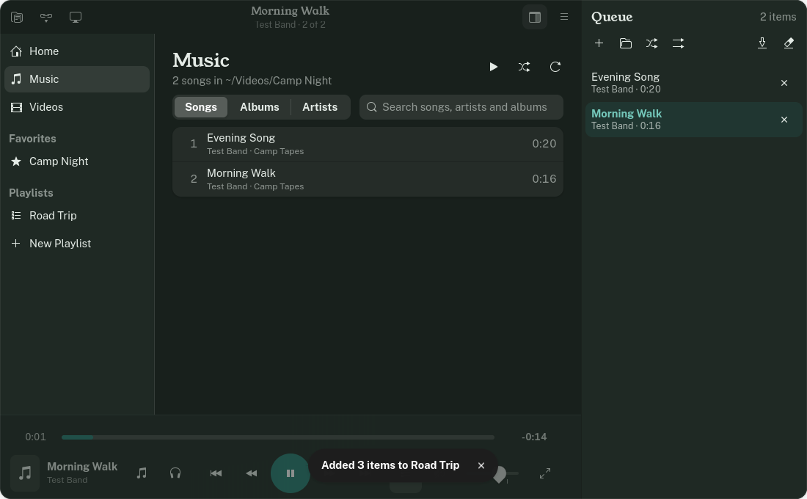
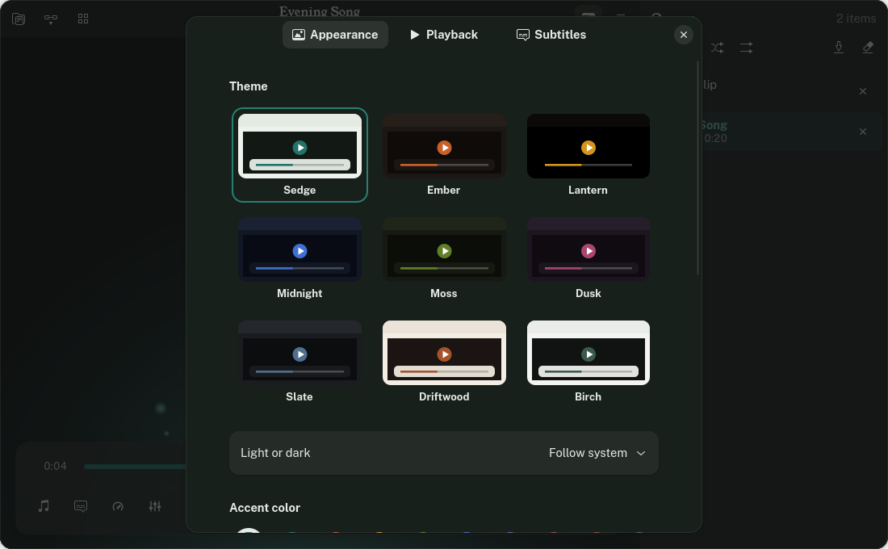

# Fireside

*Part of the Sedge family of webhookstudios apps.*

A media player for Linux. Fireside plays almost any video or music file, network streams and playlists, and keeps your library close by: folders with thumbnails, favorite places, saved playlists and a music section that works like a music player.


## What it does

- **Plays nearly anything** GStreamer can open: MKV, MP4, WebM, AVI, MOV, MP3, FLAC, Ogg, Opus, AAC, WAV and more, plus web streams (Ctrl+L) and `.m3u` / `.pls` lists.
- **Library.** Open a folder and see its videos as thumbnails and its music with cover art. Star a folder to keep it under **Favorites** in the sidebar.
- **Playlists.** Make your own, add songs, videos or whole folders from the right-click menu, or save the current queue (Ctrl+S). They're kept as `.m3u8` files in `~/.local/share/fireside/playlists`.
- **Music.** Everything in your Music folder by song, album or artist, with search. Music keeps playing while you browse, with the control bar along the bottom.
- **Play as audio.** Listen to just the sound of any video, from the right-click menu or the headphones button.
- **Watching.** Subtitles (found automatically next to the video, or added by hand), audio and subtitle track choice, speed from 0.25× to 4×, frame stepping, resume where you left off, snapshots, picture adjustments and a ten-band equalizer with presets.
- **Media keys** and the system's media controls work.




## Make it your own

Preferences → Appearance has nine color themes (Sedge, Ember, Lantern, Midnight, Moss, Dusk, Slate, Driftwood and Birch), ten accent colors, and three control bars: **floating** over the video, **docked** under it, or one **minimal** row. You can also change corner roundness, seek bar thickness, bar opacity, how quickly the controls hide, and what music shows behind it (drifting embers, cover art or plain).



## Keys

| Key | Does |
| --- | --- |
| Space or K | Play or pause |
| Left / Right | Skip back or forward (Shift for six times as far) |
| Up / Down, M | Volume, mute |
| , and . | Step one frame |
| [ ] = | Slower, faster, normal speed |
| N / P | Next, previous |
| V / B | Next subtitle / audio track |
| A | Change the video size |
| S | Snapshot |
| F, Esc | Fullscreen, leave fullscreen |
| F9 | Show the queue |

Ctrl+? lists every shortcut.

## Requirements

- Ubuntu 24.04 or newer with GNOME (GTK 4, libadwaita 1.8 or newer)
- GStreamer 1.22 or newer with `gstreamer1.0-gtk4`

Fireside has only been tested on Ubuntu 26.04 with GNOME 50.

## Install

### With the deb package (recommended)

Download `fireside_1.0.1_all.deb` from the [latest release](https://github.com/webhookstudios/fireside/releases/latest), then install it:

```bash
sudo apt install ./fireside_1.0.1_all.deb
```

The package also pulls in the common codecs. From a terminal, run `fireside`, optionally with files or a folder.

To remove it:

```bash
sudo apt remove fireside
```

### From source

```bash
git clone https://github.com/webhookstudios/fireside.git
```

```bash
cd fireside && PYTHONPATH=. python3 -m fireside
```

`./install.sh` adds a menu entry that runs Fireside from the cloned folder.

## Your data

- Settings: `~/.config/fireside/settings.json`
- Resume points, recent files and the music index: `~/.local/state/fireside/`
- Playlists: `~/.local/share/fireside/playlists/`
- Video thumbnails go in the shared thumbnail cache, so the Files app can use them too.

## Tests

`tests/ui.py` drives the real window against a folder with a short video, a matching `.srt` and two tagged MP3s, and takes screenshots:

```bash
python3 tests/ui.py MEDIA_FOLDER [SCREENSHOT_FOLDER]
```

## License

GPL-2.0-or-later. The Young Serif and Public Sans fonts are under the SIL Open Font License.
