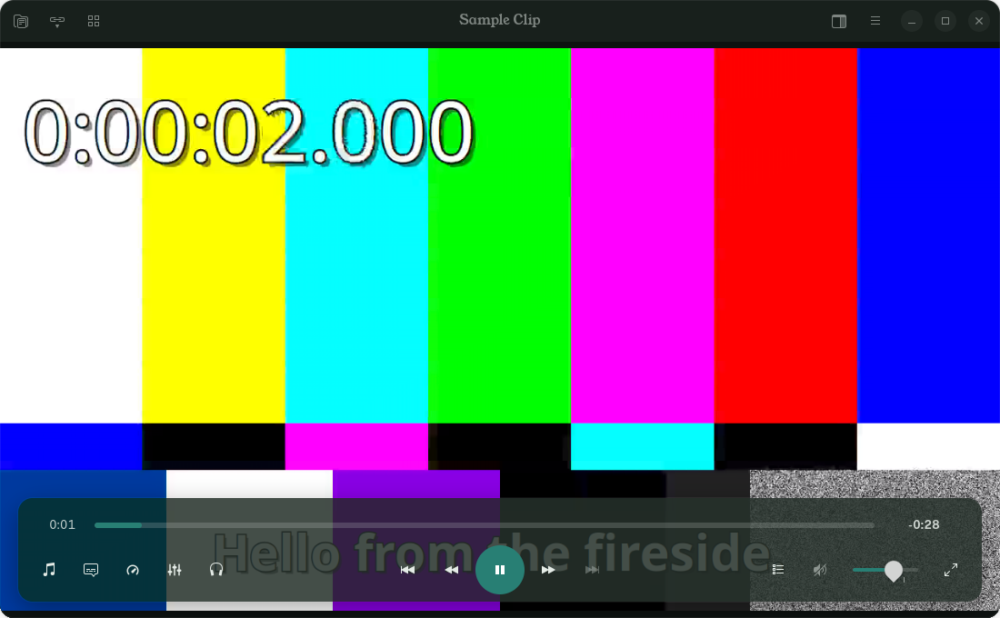
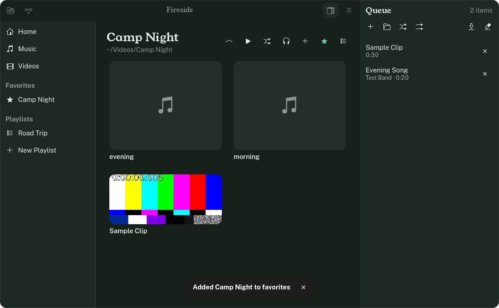
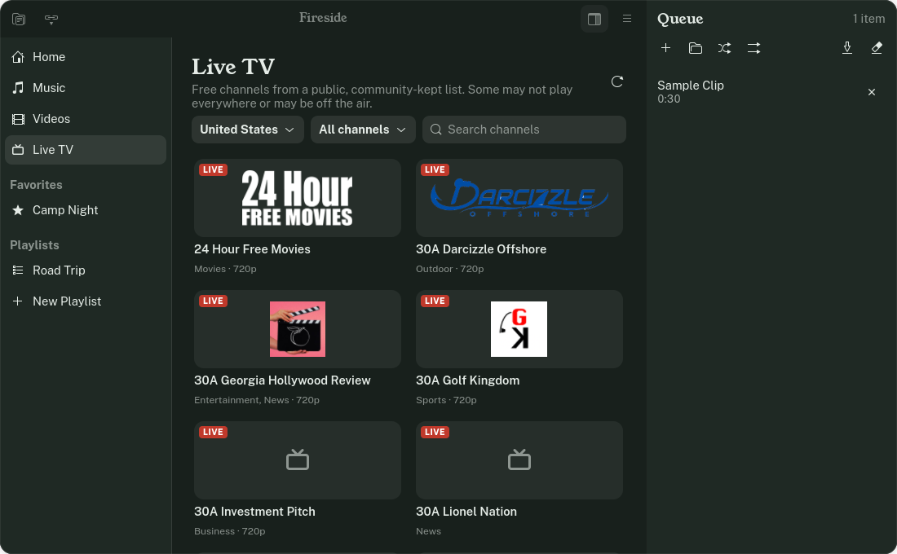
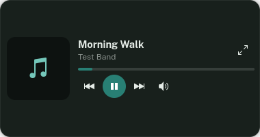

# Fireside

*Part of the Sedge family of webhookstudios apps.*

A media player for Linux. Fireside plays almost any video or music file, network streams and playlists, and keeps your library close by: folders with thumbnails, favorite places, saved playlists, a music section that works like a music player, and free live TV.



## What it does

- **Plays nearly anything** GStreamer can open: MKV, MP4, WebM, AVI, MOV, MP3, FLAC, Ogg, Opus, AAC, WAV and more, plus web streams (Ctrl+L) and `.m3u` / `.pls` lists.
- **Library.** Open a folder and see its videos as thumbnails and its music with cover art. Star a folder to keep it under **Favorites** in the sidebar.
- **Playlists.** Make your own, add songs, videos or whole folders from the right-click menu, or save the current queue (Ctrl+S). They're kept as `.m3u8` files in `~/.local/share/fireside/playlists`.
- **Music.** Everything in your Music folder by song, album or artist, with search. Music keeps playing while you browse, with the control bar along the bottom.
- **Play as audio.** Listen to just the sound of any video, from the right-click menu or the headphones button.
- **Live TV.** Free channels by country and category, with search and starred favorites. Next and Previous flip channels. The list comes from the public, community-kept [iptv-org](https://github.com/iptv-org/iptv) project; channels that only relay another company's service are left out, and some channels may be region-locked or off the air.
- **Continue watching.** Videos you stopped partway show on Home with how much is left. Hover a tile and press × to remove it.
- **Gapless music.** Songs follow each other with no silence in between.
- **Mini player** (Ctrl+M or the button on the bar): a small window with the picture or cover art and the play buttons. Right-click it and choose Always on Top to keep it above your work.
- **Sleep timer.** Stop after 15 minutes to 1½ hours, or at the end of the current item, with a gentle fade.
- **Play on a TV or speaker.** Send what's playing to a DLNA TV or speaker on your network, or to a Chromecast when `python3-pychromecast` is installed. The bar keeps controlling it.
- **Watching.** Subtitles (found automatically next to the video, or added by hand, and shifted earlier or later when out of sync), audio and subtitle track choice, speed from 0.25× to 4×, frame stepping, resume where you left off, snapshots, picture adjustments and a ten-band equalizer with presets.
- **Media keys** and the system's media controls work.








## Make it your own

The top of the main menu has a theme and accent picker for quick changes. Preferences → Appearance has nine color themes (Sedge, Ember, Lantern, Midnight, Moss, Dusk, Slate, Driftwood and Birch), ten accent colors, and three control bars: **floating** over the video, **docked** under it, or one **minimal** row. You can also change corner roundness, seek bar thickness, bar opacity, how quickly the controls hide, and what music shows behind it (drifting embers, cover art or plain).


## Keys

| Key | Does |
| --- | --- |
| Space or K | Play or pause |
| Left / Right | Skip back or forward (Shift for six times as far) |
| Up / Down, M | Volume, mute |
| , and . | Step one frame |
| [ ] = | Slower, faster, normal speed |
| N / P | Next, previous |
| V / B | Next subtitle / audio track |
| G / H | Subtitles earlier / later |
| A | Change the video size |
| S | Snapshot |
| F, Esc | Fullscreen, leave fullscreen |
| F9 | Show the queue |
| Ctrl+M | Mini player |

Ctrl+? lists every shortcut.

## Requirements

- Ubuntu 24.04 or newer with GNOME (GTK 4, libadwaita 1.8 or newer)
- GStreamer 1.22 or newer with `gstreamer1.0-gtk4`

Fireside has only been tested on Ubuntu 26.04 with GNOME 50.

## Install

### With the deb package (recommended)

Download `fireside_1.1.1_all.deb` from the [latest release](https://github.com/webhookstudios/fireside/releases/latest), then install it:

```bash
sudo apt install ./fireside_1.1.1_all.deb
```

The package also pulls in the common codecs. From a terminal, run `fireside`, optionally with files or a folder.

To remove it:

```bash
sudo apt remove fireside
```

### From source

```bash
git clone https://github.com/webhookstudios/fireside.git
```

```bash
cd fireside && PYTHONPATH=. python3 -m fireside
```

`./install.sh` adds a menu entry that runs Fireside from the cloned folder.

## Your data

- Settings: `~/.config/fireside/settings.json`
- Resume points, recent files and the music index: `~/.local/state/fireside/`
- Playlists: `~/.local/share/fireside/playlists/`
- Video thumbnails go in the shared thumbnail cache, so the Files app can use them too.
- Live TV channel lists and logos are cached in `~/.cache/fireside/tv/`.

## Casting and your network

When you cast a file from this computer, Fireside serves just that file to the TV from a small built-in web server, under a random address, only while casting. If a firewall is on, allow incoming connections from your local network or the TV won't be able to fetch it.

## Tests

`tests/ui.py` drives the real window against a folder with a short video, a matching `.srt` and two tagged MP3s, and takes screenshots. It also casts to a stand-in TV it runs itself, and plays a live channel (that part needs the internet):

```bash
python3 tests/ui.py MEDIA_FOLDER [SCREENSHOT_FOLDER]
```

## License

GPL-2.0-or-later. The Young Serif and Public Sans fonts are under the SIL Open Font License.
